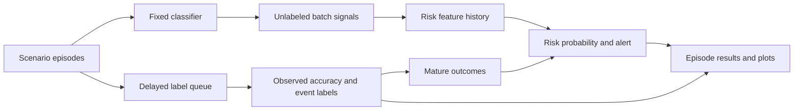

# Phase-by-Phase Implementation Plan

This is the execution roadmap for the [final scope](final_scope.md). Code is present through the Phase 6 demo path. Focused checks and the default synthetic held-out run have completed; the key performance claim failed. Read the [evaluation report](evaluation_results.md) before planning any follow-up.

## Target architecture

Keep the existing detector and model code as a source of signals. Add a small experiment path around it:

At batch `t`, generate predictions and drift signals without exposing that batch's labels to the monitor. A per-batch label arrives at `t + L`. A training target asking whether an accuracy event starts in `(t, t + H]` becomes knowable at `t + H + (K - 1) + L`, where `K` is the number of consecutive low-accuracy batches needed to confirm an event. The extra `K - 1` batches matter because event onset is recorded as the first batch in that confirmed run. Update the risk model only after this release time. Freeze the base classifier throughout.

## Phase 0 — Lock the experiment protocol

**Goal:** make the measurement rules executable before changing the detector.

**Changes**

- Add one protocol/config definition for `H = 5`, `L in {0, 2, 5}`, the five-clean-batch baseline, the two-consecutive-batch event rule, and the five-per-100-clean-batches false-alert budget.
- Record the scenario names, feature/model setup, seeds, and train/validation/test episode split in each run's metadata.
- Choose a stable binary tabular classifier and preprocessing pipeline per dataset. Train it only on the reference/training partition.
- Preserve the current prototype and legacy benchmark outputs; write new results under `artifacts/early_warning/`.

**Implemented in Phase 0:** [`dews/experiment_config.py`](../dews/experiment_config.py) defines the protocol, event definition, fixed disjoint seed groups, model specification, dataset/scenario names, output directory, and per-run metadata contract. [`scripts/show_early_warning_protocol.py`](../scripts/show_early_warning_protocol.py) prints the manifest. The Electricity benchmark and optional comparison use the shared classifier factory. The Phase 3 runner calls `metadata_for_run(...)` and persists the returned metadata in each episode ledger.

**Gate:** passed. The protocol manifest prints the classifier, horizon, event rule, delays, seed splits, and target maturity schedule. Episode ledgers retain run metadata. No parameter was selected from final-test results.

## Phase 1 — Correct event and alert accounting

**Goal:** ensure a warning metric means an alert before a measured performance event.

**Changes**

- Extract pure event logic from [`dews/temporal_benchmark.py`](../dews/temporal_benchmark.py): baseline accuracy, sustained-degradation onset, risk targets, alert/event matching, and episode metrics.
- Define event onset as the first of two consecutive batches at least five percentage points below the mean accuracy of the five clean pre-intervention batches.
- For a risk example at `t`, set `y_t = 1` when event onset is in batches `t+1` through `t+5`; otherwise set it to `0` after the complete horizon is observed.
- Mark a no-event episode's warning lead and detection lag as not applicable. Keep its actual alert count as a normal-period/harmless-shift false-alert measure; never turn a missing event into zero false alerts.
- Count one matched alert per event for event recall/lead; separately retain duplicate alerts for alert-rate metrics.

**Likely files:** new `dews/early_warning_metrics.py`; update `dews/temporal_benchmark.py` and `benchmarks/compare_monitoring.py`; add `tests/test_early_warning_metrics.py`.

**Implemented in Phase 1:** [`dews/early_warning_metrics.py`](../dews/early_warning_metrics.py) now contains the fixed-baseline event rule, complete-horizon future-risk targets with delayed maturity, one-alert-per-event matching, and explicit no-event metrics. The Electricity benchmark and the DEWS/Evidently/NannyML comparison use the same event matcher. Clean false-alert rates use the stable pre-warning region for event episodes and all batches for no-event episodes. The comparison report records its event definition and keeps alert counts, matched events, lead/lag, and false-alert rates distinct.

**Gate:** hand-constructed timelines cover an early warning, a late detection, a missed event, duplicate alerts, and a no-event stream. Every case returns the expected metric values.

## Phase 2 — Build controlled scenario episodes

**Goal:** separate harmless input change from changes that actually reduce classifier accuracy.

**Changes**

- Create a dedicated `dews/scenarios.py` rather than extending the current mixed-intervention generator indefinitely.
- Implement four deterministic scenarios: `clean`, `harmless_shift`, `harmful_gradual`, and `harmful_abrupt`.
- Make the harmless shift affect a known non-predictive/noise feature. Make harmful scenarios alter predictive inputs or their relationship with the target so the fixed classifier can cross the event definition.
- Keep intervention type, onset, magnitude, seed, baseline rows, stream labels, and expected event metadata in a scenario object.
- Do not mix feature and label interventions in one scenario. If a pure label-only relationship change is included, label it as an observability-limit probe rather than a detector success case.
- Generate enough clean batches before onset to establish the baseline and enough post-onset batches to evaluate the five-batch horizon.

**Likely files:** new `dews/scenarios.py`; retain or deprecate the old `build_demo_scenario` in `dews/data.py`; add `tests/test_early_warning_scenarios.py`.

**Implemented in Phase 2:** [`dews/scenarios.py`](../dews/scenarios.py) adds a separate deterministic episode generator and matched scenario-suite builder. All four scenarios share the same seeded latent data and reference-only classifier. The harmless case shifts a classifier-irrelevant nuisance feature; gradual and abrupt cases shift a predictive feature while preserving the latent labels. Each episode records the intervention and computes evaluation-only accuracy/event metadata with the frozen classifier. The 50-seed, four-scenario sweep and held-out scenario checks passed.

**Gate:** passed for the configured seed range: 200 episodes (50 seeds by four scenarios) generated without failure, and the held-out test cohort contained 10 confirmed events in each harmful scenario and none in the clean or harmless-shift scenarios.

## Phase 3 — Add the batch ledger and delayed-feedback simulator

**Goal:** enforce label availability in the actual execution order, not only in documentation.

**Changes**

- Add a per-episode runner, likely `dews/early_warning.py`, that processes each batch in this order:
  1. Release labels and risk targets from earlier batches whose availability time has arrived. For `L = 0`, release the current batch's labels only after its live signal and risk prediction have been recorded.
  2. Pass matured examples to the risk updater only; before Phase 4, retain them in the ledger without fitting a risk model.
  3. Predict labels/probabilities for the current feature batch and calculate drift/confidence signals.
  4. Build risk features from current and past signals, then emit the risk probability and alert.
  5. Queue the batch labels for release at `t + L` and queue risk target `y_t` for release at `t + H + (K - 1) + L`.
  6. After the live step, release any outcomes that mature at the current clock, so they can affect only later predictions.
- Call the existing monitoring pipeline with `batch_labels=None` during the live step. Calculate actual accuracy in a separate evaluator only when the batch labels mature.
- Store one auditable record per batch: episode/scenario/seed, `t`, signal features, prediction summaries, risk features, probability, alarm, label release time, realized accuracy (only after maturity), target release time, and event metadata.
- Mark future-derived fields as evaluation-only. They must never be passed into `RiskFeatureBuilder` or the predictor.

**Likely files:** new `dews/early_warning.py` and optionally `dews/risk_features.py`; no changes to Kafka, Celery, Redis, Grafana, or retraining code.

**Implemented in Phase 3:** [`dews/early_warning.py`](../dews/early_warning.py) replays a `ScenarioEpisode`, fits the fixed classifier on reference rows only, and calls the monitoring system with `batch_labels=None`. Its separate evaluator releases batch accuracies and future-risk targets at their protocol maturity times. Each batch record stores causal signals/features, prediction summaries, fixed-score alerts, release times, and evaluation-only outcomes that remain unset until maturity. Predictor/updater callbacks provide the Phase 4 seam. Per-run JSON is written under `artifacts/early_warning/`.

**Gate:** focused tests pass for label release, risk-target maturity, and the absence of future labels from the live monitor. The per-episode ledgers record each label and target availability time.

**Implemented in Phase 4:** [`dews/risk.py`](../dews/risk.py) builds current, lagged, rolling-mean, and slope features from unlabeled signals; computes statistical-only, confidence-only, fixed-score, and recent-slope baseline scores; fits a logistic calibrator from training-split matured targets; and provides a validation-only threshold selector under the false-alert budget. [`dews/early_warning.py`](../dews/early_warning.py) records these baselines, applies configured baseline alarms, and uses the fixed-score fallback while the risk calibrator is not ready. The calibrator's updater rejects targets before their recorded availability time and ignores duplicate episode examples. The Phase 4 leakage, maturity, matched-alert-budget, and configured-seed gates are still open.

## Phase 4 — Implement matched baselines and the risk calibrator

**Goal:** compare a small, explainable risk layer against the current score under the same alert budget.

**Changes**

- Build baselines from the same batch record: statistical-only, confidence-only, the fixed weighted score, and a recent-slope forecast of that score.
- Build `RiskFeatureBuilder` from current and lagged `S_stat`, confidence summaries, rolling means, and slopes. Exclude future labels, future accuracy, and post-`t` signals.
- Start with a lightweight logistic risk model. Train on past episode examples; for streaming updates, refit or incrementally update only from targets that matured before the current prediction. Never revise predictions already recorded for earlier batches.
- Use episode/seed partitions, not random rows: training seeds for initial model fit, validation seeds for model/threshold selection, and untouched test seeds for final results. Reuse the same held-out episodes for each label-delay setting.
- Tune the warning threshold on validation episodes to meet the five-alerts-per-100-clean-batches budget. Freeze that threshold for test. Log when there is insufficient mature data to update the calibrator.
- Use a documented fallback (the fixed-score baseline) until the risk model has sufficient mature examples; do not silently emit a learned probability from an untrained model.

**Likely files:** new `dews/risk.py`; add `tests/test_risk_features.py`, `tests/test_delayed_feedback.py`, and `tests/test_risk_model.py`.

**Gate:** focused tests pass for feature-leak rejection, target maturity, validation-only threshold selection, false-alert budget selection, and held-out label release. The measured held-out result does not support the risk method's performance claim.

## Phase 5 — Run the held-out evaluation

**Goal:** establish whether the contribution improves warning quality beyond an input-drift alarm.

**Changes**

- Use multiple independent seeds for each of the four controlled scenarios; split whole seeds/episodes into train, validation, and test partitions.
- Run all three delays (`0`, `2`, `5`) from the same initial model and scenario seeds. For each delay, replay the stream with the correct feedback release schedule.
- Run the chronological Electricity check separately. Keep its real labels hidden from the monitor until their simulated release. If it has no event under the fixed rule, report it as no confirmed degradation.
- Produce per-episode JSON ledgers and aggregate JSON with mean/variability across episodes. Include scenario, delay, event presence/onset, alerts, false alerts, lead/lag, recall, Brier score, and runtime.
- Plot risk probability, fixed score, threshold, event onset, label-availability boundary, and realized accuracy on aligned batch axes.
- Compare the risk model with all required baselines. Report the result even if the risk model does not win.

**Likely files:** `scripts/run_early_warning_experiment.py`; `scripts/plot_early_warning_episode.py`; outputs in `artifacts/early_warning/`; add `tests/test_early_warning_experiment.py` for a small deterministic replay.

**Gate:** final-test metrics are generated from frozen validation choices; no-event rows have not-applicable lead/lag; aggregated values can be traced back to episode-level records. Improvement is claimed only if it appears on held-out episodes at the fixed false-alert budget.

**Implemented and run in Phase 5:** [`scripts/run_early_warning_experiment.py`](../scripts/run_early_warning_experiment.py) completed the default train/validation/test split and wrote per-episode ledgers plus aggregate JSON with Brier scores, reliability bins, and runtime. [`scripts/plot_early_warning_reliability.py`](../scripts/plot_early_warning_reliability.py) produced a held-out calibration plot, which was inspected. The report records a negative result: 0/20 harmful events detected by the risk calibrator at each delay, versus 9/20 by the fixed-score baseline, all after onset. No fresh Electricity run was possible because the local data file is absent.

## Phase 6 — Build one reliable demonstration

**Goal:** make the research question understandable in under five minutes without Docker.

**Changes**

- Add a demo option that replays one fixed held-out `harmful_gradual` episode and one `harmless_shift` episode with `L=2`.
- Use the same frozen classifier, risk model, and threshold for both episodes.
- Print a concise summary and save a single comparison plot per scenario. Keep the CLI and Matplotlib; do not add another dashboard framework.
- Show that the harmful episode has a measured accuracy event and the harmless episode changes inputs without crossing the event rule.
- Include a fixed-score versus risk-calibrator comparison on the same axes and clearly mark when labels become available.

**Likely files:** `scripts/run_early_warning_experiment.py`, `scripts/plot_early_warning_episode.py`, and `docs/usage.md`.

**Gate:** a clean local setup can run the demo with one documented command and produce all expected artifacts without Kafka, Redis, Celery, external data downloads, or model files outside the repository.

**Implemented and run in Phase 6:** [`scripts/run_early_warning_demo.py`](../scripts/run_early_warning_demo.py) loads the training-fitted calibrator and validation thresholds, then runs matched `harmful_gradual` and `harmless_shift` episodes with the same held-out seed and `L=2`. It resets online state between episodes and writes a summary, ledgers, and timeline plots under `artifacts/early_warning/demo/`. The result demonstrates the miss honestly: the risk model issued no warning for the harmful episode. It is not a successful-warning demonstration.

## Phase 7 — Finalize report and repository claims

**Goal:** make every claim in the project match code and evidence.

**Changes**

- Keep [`README.md`](../README.md), [`docs/final_scope.md`](final_scope.md), this implementation plan, [`docs/usage.md`](usage.md), and the short legacy benchmark note as the maintained documentation set.
- Add the final protocol, experiment split, baselines, event definition, metrics, results, limitations, and claim-to-evidence table to the report/presentation materials.
- Remove any remaining claim of production readiness, automatic retraining, generic concept-drift detection, or benchmark superiority unless directly demonstrated.
- State that the predictor estimates risk; it does not establish causality or guarantee model failure.

**Gate:** every metric, novelty statement, and demo command in the report can be traced to current code and saved outputs.

**Status:** the README, scope, usage guide, implementation plan, and [evaluation report](evaluation_results.md) now reflect the run. The primary early-warning improvement claim is not supported. Remaining work is a fresh Electricity check when data is available and final presentation/report materials that preserve the negative result. API `TestClient` checks also remain unverified because the local blocking portal hangs, including for a minimal FastAPI app.

## Execution rules

- Work phase by phase; do not build Kafka/production support during this project.
- Do not tune on test episodes or change the event rule after seeing test results.
- Keep old prototype outputs separate from `artifacts/early_warning/`.
- If the calibrator fails to outperform the fixed score, preserve that result and finish the report; do not expand scope to force a positive result.
- Add and run focused verification for new behavior as each phase is implemented. No implementation or test execution is included in this roadmap document.

## Current next task

Do not tune against the completed test cohort. If the project needs another model iteration, predeclare it as a new experiment and use fresh episode seeds. Complete the chronological Electricity check only after obtaining a local dataset copy, and prepare the final presentation from the current negative result and limitations.
